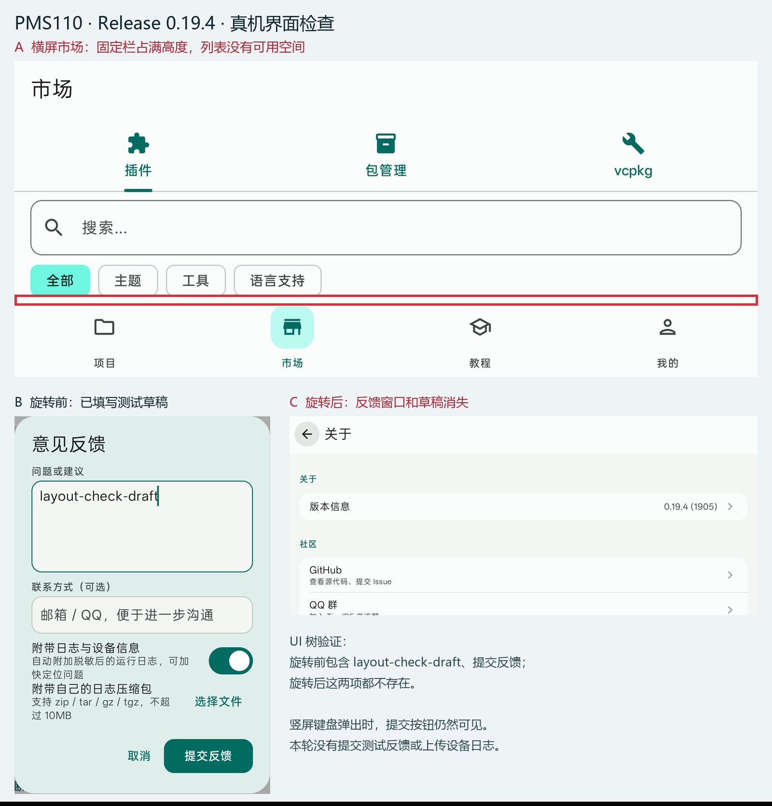

# 2026-11-16 PMS110 Release 安装与界面审查

已在 PMS110 真机通过 `adb install -r` 覆盖安装 Release `0.19.4`，保留原有应用数据。启动与本轮浏览过程中进程持续存活。优先处理反馈旋转丢失和横屏市场列表被挤出两项问题。

## 验收对象与范围

- 设备：PMS110，Android 17，`arm64-v8a`，屏幕 1272 × 2772、560 dpi；横屏为 2772 × 1272。
- APK：`app/build/outputs/apk/arm64/release/TinaIDE-0.19.4-arm64-v8a-release.apk`。
- 版本：`versionName=0.19.4`、`versionCode=19052`；构建源码提交 `5a696d619`。
- SHA-256：`07EF4E84E83D3FC2366CE6219AC90DB22E496A98D0555835D57F64341FED3308`。
- 实测：项目首页、市场、我的、关于、反馈表单、键盘和横竖屏切换。
- 代码审查：反馈状态保存、提交取消、日志附件模式、崩溃上传状态显示。
- 未覆盖：编辑器与 native 项目编译/运行、完整新手引导、后台网络故障注入、connected instrumentation、真实反馈/设备日志上传。本轮未提交测试反馈。

本次安装包来自干净检出；主工作区尚有市场代理、搜索、vcpkg、编辑器等未提交改动。这些改动没有包含在手机上的 APK 中，不能将当前工作区视为已经真机验证的界面版本。

## 截图概览

截图只保留 TinaIDE 内容，移除了系统通知和状态栏。横屏截图中红框表示列表本应显示的位置。

## 问题与处理顺序

| 优先级 | 问题 | 证据 | 建议 |
| --- | --- | --- | --- |
| P1 | 旋转屏幕关闭反馈窗口，已写内容丢失 | 真机复现 + UI 树 + 代码确认 | 保存表单与打开状态，附件由能跨配置变化的状态持有者管理 |
| P1 | 横屏市场固定栏占满高度，列表几乎无可用空间 | 真机截图 + 已安装版本布局代码 | 合并搜索与顶栏，压缩分类区；短高度布局使用紧凑导航或侧边导航 |
| P2 | 反馈提交期间无法主动取消 | 代码确认，未注入弱网 | 提供取消请求的操作与整体超时，保留草稿和已接收报告 ID |
| P2 | 崩溃上传状态不会随后台任务实时变化 | 代码确认，未触发真实崩溃上传 | 使用 Flow/偏好监听更新状态；恢复页面时同步一次 |
| P2 | 自动日志与自选压缩包看起来会同时发送，实际只发后者 | 表单截图 + 提交分支代码 | 把日志附件明确表达成“无 / 自动收集 / 选择已有包”三种模式 |

### P1：旋转丢失反馈草稿

复现：进入“我的 → 关于 → 意见反馈”，输入 `layout-check-draft`，保持键盘弹出并旋转到横屏。结果是反馈窗口消失，返回关于页；原窗口中的文本和附件状态没有保存。

UI 树证据：[rotation-evidence.json](evidence/pms110-ui-2026-11-16/rotation-evidence.json)。旋转前存在草稿与“提交反馈”，旋转后均不存在。对应截图：[旋转前](evidence/pms110-ui-2026-11-16/feedback-draft-before-rotation.png)、[旋转后](evidence/pms110-ui-2026-11-16/feedback-after-rotation.png)。

根因：`AboutSettingsSection.kt:56` 使用普通 `remember` 保存 `showFeedbackDialog`；`FeedbackDialog.kt:62` 起的消息、联系方式与附件状态同样使用普通 `remember`。Activity 重建时窗口打开状态与内容一起重置；附件清理的 `DisposableEffect` 也随窗口销毁执行。

建议复用现有状态管理：打开状态、消息、联系方式与附件模式使用 `rememberSaveable` 或保存到 `SavedStateHandle`；缓存文件的生命周期放到表单 ViewModel 中，成功、明确取消或真正退出表单时再清理。不要仅保存文件名而继续在配置重建时删除文件。

验收标准：输入多段中文、联系方式并选一个测试附件，连续横竖屏切换后内容和附件仍可读；取消后按既定策略清理缓存；成功提交只产生一份报告。

### P1：横屏市场缺少内容空间

复现：在门户进入“市场 → 插件”，将手机横置。顶部标题、带图标的 Tab、独立搜索框、分类 Chip 和底栏占用全部短边高度，列表区域几乎为零。[真机截图](evidence/pms110-ui-2026-11-16/market-landscape.png)。

根因：`MainScreen.kt:138` 始终使用底栏；`TinaBottomBar.kt:84` 固定 80 dp。已安装版本 `MarketScreen.kt` 依次堆叠 TopBar、带图标 Tab、搜索和分类条，没有针对短高度窗口降级。横屏“我的”页也保留同样的大底栏，首屏只能看到少量菜单项。

主工作区的未提交 `MarketScreen.kt` 已将搜索移入顶栏、删除独立分类条，方向能缓解这项问题；该版本尚未编入本次 APK。`MainScreen` 与固定底栏仍需一起考虑，不能仅根据工作区源码宣布真机问题已修好。

建议先验证现有搜索调整，再按可用高度选择紧凑 Tab 与侧边导航，不通过把字体和点击目标一律缩小来挤空间。验收时同时检查三个市场 Tab 的列表、空态、错误态与刷新入口，并覆盖竖屏、横屏和大字体。

### P2：反馈提交无法取消

`FeedbackDialog.kt:116` 阻止提交期间关闭窗口，取消按钮在 `229` 行也不执行操作；网络层 `AegisHubClient.kt:53` 设置较长单次请求超时并最多重试三次。界面只有“提交中”文案，弱网时用户没有主动停止操作的入口。

建议使用可取消 Job、明确整体等待上限，并让取消与“返回编辑”保留草稿。报告已收取但附件还在上传时，要保存报告 ID，仅重试附件。这一项来自代码审查，本轮没有在真机制造超时。

### P2：上传状态显示不实时

`AboutSettingsSection.kt:57` 只在首次组合读取 `CrashUploadState` 快照，`400` 行仅在切换自动上传开关时重读。后台任务更新偏好后，这个页面没有对应的监听，会继续显示旧快照。

建议把现有偏好变化转换为 Flow，在 UI 用 `collectAsStateWithLifecycle` 观察；补页面恢复时同步。不应通过要求用户切换开关来刷新状态。验收需验证 QUEUED、UPLOADING、UPLOADED、FAILED 转换时界面自动变化。本轮没有触发真实崩溃上传来验证状态转换。

### P2：日志附件的交互关系不清

[反馈表单](evidence/pms110-ui-2026-11-16/feedback-portrait.png) 同时出现“附带日志与设备信息”开关和“附带自己的日志压缩包”。从呈现上容易理解为叠加附件，但 `FeedbackDialog.kt:296` 的代码优先使用自选文件，只有未选择文件时才自动收集。

建议使用明确的三选一模式；选择已有包后显示文件名、大小、移除/更换和“替代自动日志”的说明。当前竖屏键盘弹出时提交按钮仍然可见，不将其记录为遮挡问题。

## 验证边界与交付

- 覆盖安装成功，进入 `MainPortalActivity`，浏览过程中同一主进程仍存活；检查的退出历史没有本次安装后的崩溃/ANR。
- 本轮没有读出私有迁移完成标记，也没有收到新的真机 AegisHub 上传回执。关于页里已有的“已上传”历史状态不能作为新后端真机回执使用。
- 手机前台期间被用户切换到其他应用，采集发现非 TinaIDE 前台时停止；之后恢复自动旋转。报告证据不包含其他应用截图或内容。
- 本轮只更新验收记录与审查材料；建议修复优先顺序是先保住反馈草稿、恢复横屏列表空间，再处理上传状态与附件交互。源文件和报告均采用 UTF-8，无 BOM。
